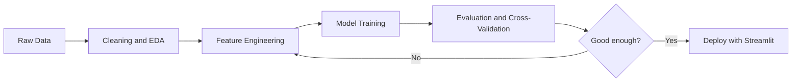

<div align="center">

# I'm Azhar Ali

### 🧠 Machine Learning &nbsp;•&nbsp; 📊 Data Science &nbsp;•&nbsp; 🏆 Kaggle

*I don't just train models. I chase the leaderboard, learn from every submission, and ship what I build.*

[](https://www.kaggle.com/azharalisoomro)
[](https://www.linkedin.com/in/mrazharali)
[](https://leetcode.com/u/AzharAli336/)
[](mailto:azharaliofficial0521@gmail.com)


</div>

---

## 🧬 About Me

```python
class Azhar:
    def __init__(self):
        self.role         = "CS Student (AI Specialization) @ Sukkur IBA University"
        self.scholarship  = "PEEF"
        self.passion      = ["Kaggle Competitions", "Machine Learning", "Data Analysis"]
        self.languages    = ["Python", "SQL", "Java", "C++"]
        self.looking_for  = "Data Science internship"

    def while_others_sleep(self):
        return "Debugging a notebook and trying one more feature to climb the leaderboard."

    def mission(self):
        return "Turn messy data and real problems into models and products people can use."
```

> 💡 **My style:** clear code, a clear strategy, and a reason behind every experiment. Not the most complex model, the most *intentional* one.

---

## 🏆 Kaggle and Competitions

<table>
<tr>
<td>

### 🔥 Currently competing
**Predicting Soil Grain Size Distributions from Images**
Predicting soil grain size distributions from photos, with a step-by-step notebook approach and a focus on learning from every submission.

[](https://www.kaggle.com/azharalisoomro)

</td>
</tr>
</table>

| Achievement | Details |
|---|---|
| 🥈 **IBA Karachi ProBattle** | Ranked **19th of 50 teams** in the ML competition |
| 🚀 **Comeback Pakistan** | Selected from **1,000+ applicants**. Squad placed **3rd of 13** at Demo Day |
| 📈 **Kaggle notebooks** | Titanic survival EDA, GDP time-series analysis and more |

---

## 🔄 How I Approach an ML Problem



---

## 🛠️ Tech Stack

<div align="center">

**Languages**


**Machine Learning and Data**


**Platforms and Tools**


**Databases**


</div>

<details>
<summary><b>🧠 ML toolkit in detail (click to expand)</b></summary>

<br/>

- **Algorithms:** Decision Trees, Naive Bayes, KNN, Linear and Logistic Regression, SVM
- **Evaluation:** Confusion Matrix, Precision, Recall, F1, ROC-AUC, Cross-Validation, Regularization
- **Data work:** Data Cleaning, EDA, Feature Engineering

</details>

---

## 🚀 Featured Projects

### 🤖 Machine Learning and AI

| Project | What it does | Tech | Activity |
|---|---|---|---|
| 🎬 [**Movie Recommendation System**](https://github.com/Azharaliii/Movies-Recommendation-System) | Suggests similar movies using cosine similarity, shows the top 10 matches and fetches live posters from the TMDB API | `Python` `Scikit-learn` `Streamlit` |  |
| 🧭 [**PathAi 360**](https://github.com/Azharaliii/PathAi-360) | Career guidance from a personality assessment. Refactored a ~2,000-line single file into a clean modular codebase | `Python` `Streamlit` `MongoDB` |  |
| 🏦 [**Bank Route AI Complaint System**](https://github.com/Azharaliii/Bank-Route-AI-Driven-complaint-system) | Classifies customer complaints by type and routes them by priority so urgent ones are handled first | `Python` `Machine Learning` |  |
| 📱 **UpTally** | AI tool for Upwork freelancers to evaluate jobs. As Product Manager I led user research, MVP planning, logo, branding and landing page | `AI` `Product` `Design` | MVP shipped in 8 weeks |

### 📊 Data Analysis and EDA

| Project | What it does | Tech |
|---|---|---|
| 📱 [**Samsung Global Product Sales**](https://github.com/Azharaliii/Samsung-Global-Product-DataSet-Analyze) | Sales by region and age group using correlation, skewness and heatmaps | `Pandas` `NumPy` `Seaborn` |
| 🌾 **Pakistan Wheat Deficit Analysis** | 25 years of FAOSTAT and World Bank data to estimate the yield needed for self-sufficiency by 2030 | `Pandas` `NumPy` `Matplotlib` |
| 📚 **Guftgu Publications Order Analysis** | 1,000+ book orders: top titles, top cities, revenue over time | `Pandas` `NumPy` `Matplotlib` |
| 🚢 [**Titanic Survival Analysis**](https://github.com/Azharaliii/Titanic-EDA-Kaggale-Data-Set-) and GDP Time-Series | 891 passenger records with 10+ visualizations, plus GDP trends for 190+ countries (2020 to 2025) | `Pandas` `Matplotlib` `Seaborn` |

[](https://github.com/Azharaliii?tab=repositories)

---

## 🎮 Game Zone: My Contribution Snake

<div align="center">

*A snake is eating my GitHub contributions. The more I commit, the more it eats. Keep coding, keep the snake hungry!* 🐍

<picture>
  <source media="(prefers-color-scheme: dark)" srcset="https://raw.githubusercontent.com/Azharaliii/Azharaliii/output/github-snake-dark.svg" />
  <source media="(prefers-color-scheme: light)" srcset="https://raw.githubusercontent.com/Azharaliii/Azharaliii/output/github-snake.svg" />
  
</picture>

</div>

**Currently:** 🔭 competing on Kaggle &nbsp;•&nbsp; 🧠 going deeper into ML and AI agents &nbsp;•&nbsp; 🤝 looking for a Data Science internship

---

## 🎓 Education and Leadership

- **BS Computer Science (AI Specialization)**, Sukkur IBA University | PEEF Scholarship recipient
- 📜 Data Analytics Essentials, Cisco Networking Academy (2026)
- 📜 Agentic AI and AI Agents, Vanderbilt University (Coursera)
- 🎓 Executive Committee Member, Sukkur IBA Students' Council
- 🌐 Campus Ambassador, CS Connect Pakistan | Class Representative

---

<div align="center">

### 🤝 Let's build something with data

[](https://www.linkedin.com/in/mrazharali)
[](https://www.kaggle.com/azharalisoomro)
[](mailto:azharaliofficial0521@gmail.com)

*⭐ If you like something here, drop a star on the repo.*

</div>
